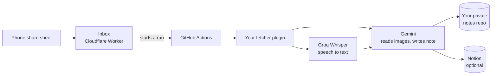

# Share to Notes

Share a link from your phone. A few minutes later it's a tidy, searchable note.

Share to Notes turns posts and videos you save into Markdown notes that you, Notion and AI assistants
like Claude can read. Each note has a summary, the key points, every item in a list, things to try,
and the full extracted text: caption, spoken transcript, on-screen text and slide text.

It runs on free tiers only: Cloudflare Workers, GitHub Actions, Groq, Google Gemini and, if you want it,
Notion. Nothing runs on your computer. As of November 2026, none of these services need a card for their
free tier. Plans change, so check each provider's pricing page before you sign up.



## What you get

- **One page per post**, sorted into category folders, with a cover image.
- **`Home.md` and `Index.md`**, rebuilt every run, so an AI assistant can find things quickly.
- **Notion sync**, if you want it: a database page per post, with a Read tick that survives rewrites.
- **Red Failed cards** for posts that couldn't be processed, so nothing goes missing quietly.
- **An Allowance card** you can embed anywhere. It shows how much free usage is left today.
- **Backups for everything.** If Groq or Gemini hits a limit, Cloudflare Workers AI takes over.

## What it doesn't do

This repo doesn't include a fetcher for any website. Out of the box it only handles direct links to
video and image files. To use it with a site, write a small fetcher plugin (see below). It's your job to make
sure your plugin only gets content you have the right to access, and that it follows the terms of the sites
you use. Pull requests that add fetchers for specific websites won't be merged.

## Set it up yourself

About 15 minutes or less. The full guide with every detail is in [docs/SETUP.md](docs/SETUP.md). In short:

1. **Fork this repo** and make a separate **private** repo for your notes.
2. **Get free keys:** Gemini (aistudio.google.com), Groq (console.groq.com) and a Cloudflare Workers AI token.
   A Notion integration token is optional.
3. **Deploy the inbox:**
   ```bash
   cd worker
   cp wrangler.example.toml wrangler.toml      # then fill it in
   npx wrangler d1 create share-to-notes       # paste the id into wrangler.toml
   npx wrangler d1 execute share-to-notes --remote --file=schema.sql
   npx wrangler secret put INBOX_TOKEN
   npx wrangler secret put GITHUB_TOKEN
   npx wrangler deploy
   ```
4. **Add GitHub secrets** to your fork: `NOTES_REPO`, `NOTES_REPO_TOKEN`, `INBOX_TOKEN`, `GEMINI_API_KEY`,
   `GROQ_API_KEY`, `CF_ACCOUNT_ID`, `CF_API_TOKEN`, and optionally `NOTION_TOKEN` and `FETCHER_ENV`.
5. **Add `settings.env`** to your notes repo with at least `INBOX_URL=...`.
6. **Make an iPhone Shortcut** that posts the shared link to `https://YOUR_INBOX/api/add`.
7. **Test it:** `gh workflow run process.yml`, then `gh run watch`.

## Set it up with an AI coding agent

Claude Code, Codex and similar tools can do most of the setup for you. The repo includes
[AGENTS.md](AGENTS.md), which tells the agent exactly what to do and what not to touch.

1. Install the GitHub CLI (`gh`) and Node.js, and sign in with `gh auth login`.
2. Clone your fork and open a terminal in it.
3. Start your agent there (for example `claude` or `codex`) and paste:

   > Set up Share to Notes for me by following AGENTS.md. Ask me before each step that creates something
   > or needs a key. Never ask me to paste a key into this chat. Use commands that prompt me for it instead.

The agent can create the repos, the database and the Worker, and walk you through the parts only you
can do: getting keys, approving logins and making the iPhone Shortcut.

**Keep your keys out of the chat.** A good agent will run `gh secret set NAME` or `npx wrangler secret put NAME`,
and you type the key into the prompt it opens. If an agent asks you to paste a key into the conversation, say no.

## Fetcher plugins

Put your plugin in your private notes repo at `private/fetcher.py`. The engine calls `fetch(url, workdir)` and
expects a dict back, or `None` if your plugin doesn't handle that link.

```python
def fetch(url, workdir):
    ...
    return {
        "media": [workdir / "01.mp4"],   # videos and images, in order
        "caption": "",
        "author": "",
        "posted": "2026-01-31",
        "shortcode": "",                 # optional stable ID
        "cover_url": "",                 # optional
    }
```

See [examples/fetcher_example.py](examples/fetcher_example.py) for the full interface. Settings for your
plugin go in the `FETCHER_ENV` secret, one `KEY=value` per line.

## Privacy

- **Your notes, plugin, settings and keys never go in this repo.** Notes, plugin and settings live in your
  private notes repo. Keys live in GitHub secrets.
- **Logs on a public fork can be read by anyone.** Quiet mode is on by default in GitHub Actions. Links,
  titles, creators and post IDs show as `<link>` and `<hidden>`, and secrets show as `***`.
- **Gemini's free tier** lets Google use what you send to improve its products. Only send public content.
- Public repos get unlimited GitHub Actions minutes. Private repos get 2,000 a month on the free plan.

## Free limits

| Service | Free limit (check the provider, these change) | Used for |
|---|---|---|
| Gemini Flash-Lite | About 500 requests a day | Reading images and writing the note. Usually the main limit |
| Groq Whisper | About 8 hours of audio a day | Speech to text |
| Cloudflare Workers AI | 10,000 neurons a day | Backup for both |
| Cloudflare Workers and D1 | 100,000 requests a day | The inbox |
| GitHub Actions | Unlimited on public repos | Running the engine |

## Licence

MIT. See [LICENSE](LICENSE). The software comes with no warranty, and you're responsible for how you use it.
